# On-Prem CodeGen

Domain-adapts an open code model to **COBOL** and serves it on our own hardware, with no external model APIs.
Every dataset, run, sweep and eval is tracked in Weights & Biases.

- **Base model:** `Qwen/Qwen3.8-27B`, fine-tuned with QLoRA (text only).
- **Benchmark:** COBOLEval, executed with GnuCOBOL; HumanEval-Python guards against forgetting.
- **Serving:** vLLM on a rented GPU, reached over an SSH tunnel.

Project brief: [docs/one-pager.pdf](docs/one-pager.pdf). Running log of decisions and results: [docs/project-log.md](docs/project-log.md).

## Contents

- [Status](#status)
- [Pipeline](#pipeline)
- [Key decisions](#key-decisions)
- [Project structure](#project-structure)
- [Setup](#setup)
- [Running on Vast.ai](#running-on-vastai)
- [SFT run](#sft-run)
- [Run the trained model](#run-the-trained-model)
- [Eval](#eval)
- [Local GPU box](#local-gpu-box)

## Status

**In progress.** Data, SFT, baseline eval and serving are done ([interim report](docs/interim-report.md)).
Preference tuning (DPO / GRPO) and the model registry step are not written yet.

| Run | COBOLEval sampled pass@1 | HumanEval-Python | Outcome | Report |
|---|---|---|---|---|
| `sft-v0` | not above base | — | first adapter; did not beat the base under the frozen protocol | [sft-v0](docs/sft-v0.md) |
| `sft-v1` | not above base | — | format defects in the training data | [sft-v1](docs/sft-v1.md) |
| `sft-v2` | 0.021 → 0.274 (seed 42), 0.282 (seed 43) | −0.041 (limit 0.02) | COBOLEval criteria met, forgetting guard not met | [sft-v2](docs/sft-v2.md) |
| `sft-gemma4` | 0.250 → 0.357 (seed 42), 0.379 (seed 43) | −0.010 | same SFT on Gemma 4 31B; CobolCodeBench completion falls 0.087 → 0.009 (answers without the program header) | [sft-gemma4](docs/sft-gemma4.md) |

## Pipeline

<picture>
  <source media="(prefers-color-scheme: dark)" srcset="docs/diagrams/pipeline-dark.svg">
  
</picture>

Each stage reads its inputs from W&B artifacts and logs a new version, so lineage from raw corpus to deployed
model is automatic.

| Stage | Input → output artifact | What happens |
|---|---|---|
| Collect | sources → `raw-corpus`, `task-pool` | The Stack v1, X-COBOL, IBM CodeNet (problems and I/O tests) |
| Clean | `raw-corpus` → `clean-corpus` | exact + MinHash dedup, decontamination against the benchmarks |
| SFT data | `task-pool` → `sft-dataset` | rejection sampling: keep generations that compile and pass the tests |
| SFT | `sft-dataset` → `adapter` | QLoRA (4-bit), TRL + PEFT |
| DPO / GRPO | `adapter` → `adapter-rl` | planned |
| Evaluate | adapter → `eval-*` | COBOLEval pass@1 / pass@10, compile rate, HumanEval-Python |
| Register | adapter → registry | planned; aliases `candidate` → `production` |

Diagram sources (HTML) live next to the SVGs in [docs/diagrams/](docs/diagrams/).

## Key decisions

**Model and training**

| Area | Decision |
|---|---|
| Base model | **`Qwen/Qwen3.8-27B`** (dense, Apache 2.0). Text part only; vision encoder frozen. |
| Comparison model | `google/gemma-4-31B-it` (dense, Apache 2.0): same data, settings and protocol as sft-v2. |
| Fine-tuning | QLoRA (4-bit) on 1× 80 GB. SFT in non-thinking mode; eval in both modes. |
| Preference tuning | DPO on offline pass/fail pairs. GRPO (compile + test reward) is a stretch goal on 2× 80 GB. |
| Stack | TRL + PEFT, Hydra configs per stage, pinned `requirements.txt`. |

**Data and evaluation**

| Area | Decision |
|---|---|
| Language, benchmark | **COBOL**; COBOLEval executed with GnuCOBOL. pass@1 / pass@10, compile rate, HumanEval-Python for forgetting. |
| Data | Stack v1 (full, we dedup), X-COBOL, CodeNet. Files are flagged (`kept`, `filter_reason`), never deleted. `.cpy` copybooks are excluded from SFT. |
| Instruction data | Rejection sampling: keep only generations that compile and pass the tests. |
| Reference | [COBOL-Coder](https://arxiv.org/html/2604.03986v1) (Dau et al.): compiler-guided validation and similarity filtering. |

**Infrastructure**

| Area | Decision |
|---|---|
| Tracking | Hosted W&B (run metadata leaves premises; data is public). |
| Compute | Vast.ai, 1× 80 GB by default, 2× 80 GB for GRPO and final runs. Ephemeral instances. |
| Serving | vLLM, OpenAI-compatible, over an SSH tunnel. OpenCode is the demo client. |

## Project structure

Keep this section up to date whenever you add, move or remove a top-level directory or module.

```
.
├── benchmarks/              # eval benchmarks, downloaded at pinned commits (gitignored, never trained on)
├── configs/                 # per stage: data/ and eval/ (yaml), train/ (Hydra)
├── data/                    # local scratch, gitignored except manifests/ (one YAML per source)
├── docker/                  # train, serve, eval-sandbox images
├── docs/                    # project brief, dataset plan, contracts, project-log.md, evaluation reports
│   └── diagrams/            # README diagrams: HTML sources and exported SVGs (light and dark)
├── scripts/                 # vast_onstart.sh (bootstrap), vast_serve.sh (serve base + adapter), sft_v1_queue.sh (SFT queue, sft-v1 and sft-v2)
├── src/onprem_codegen/
│   ├── prompt.py            # build_prompt, shared by SFT data and eval
│   ├── utils.py
│   ├── data/                # collect, filters, dedup, decontaminate, clean, CodeNet, rejection sampling,
│   │                        # held-out task split, fixed format + GOBACK, completion rows
│   ├── train/               # SFT (DPO, GRPO planned)
│   ├── eval/                # sandboxed execute(), benchmark loader, generate -> execute -> metrics -> W&B, held-out test,
│   │                        # verdict by the preregistered criteria, format repair diagnostic
│   └── serve/               # adapter key fix for vLLM, server check
├── tests/
├── tasks/                   # local plans (gitignored)
├── .claude/rules/           # Claude Code rules by topic (workflow, W&B, data, Vast, code style, writing)
├── docker-compose.yml       # local GPU box only
├── Makefile                 # entry points
├── ruff.toml                # lint config (`make lint`), no auto-formatting
└── .env.example
```

## Setup

1. Clone and install:

   ```bash
   git clone <repo-url> && cd on-prem-code-generation
   pip install -r requirements.txt
   ```

2. Fill in secrets (`WANDB_*`, `HF_TOKEN`, `VLLM_VERSION`):

   ```bash
   cp .env.example .env
   ```

3. Check the install:

   ```bash
   make test
   ```

**Make targets**

| Command | What it does |
|---|---|
| `make codenet` | CodeNet COBOL parts and `task-pool` artifact |
| `make data` | `raw-corpus` then `clean-corpus` |
| `make sft-data` | rejection sampling against the vLLM server, then `sft-dataset` |
| `make train` | SFT (`make train-smoke` for a smoke run) |
| `make decontam ARGS="--artifact sft-dataset:vN"` | check one dataset version against the benchmarks |
| `make benchmarks` | fetch pinned benchmarks, log `benchmark-*` artifacts |
| `make eval` | generate, execute, metrics (also `eval-generate`, `eval-execute`) |
| `make lint` | ruff check |

## Running on Vast.ai

Vast instances are containers, so there is no `docker compose` there.

**Rules**

- ≥ 200 GB disk, datacenter hosts only.
- Secrets (`WANDB_API_KEY`, `WANDB_ENTITY`, `WANDB_PROJECT`, `HF_TOKEN`, `GITHUB_TOKEN`) are set once under
  **Account → Environment Variables**, never baked into images.
- Every stage must restart on a fresh instance: inputs and outputs in W&B, checkpoints with resume.
- Destroy the instance when done.

**Steps**

1. Build and push the image (Linux x86 recommended):

   ```bash
   docker buildx build --platform linux/amd64 -f docker/train.Dockerfile -t $REG/onprem-codegen-train:$TAG --push .
   ```

2. Rent an instance and connect:

   ```bash
   vastai search offers 'num_gpus=1 gpu_ram>=80 disk_space>=200 datacenter=true reliability>0.98' -o 'dph'
   vastai create instance <OFFER_ID> --image $REG/onprem-codegen-train:$TAG --disk 200 --ssh --direct
   ssh -p <PORT> root@<HOST>
   ```

3. Run the stage in `tmux`:

   ```bash
   cd /workspace && git clone <repo-url> && cd on-prem-code-generation
   tmux new -s run
   python -m onprem_codegen.train.sft ...
   ```

4. Destroy the instance:

   ```bash
   vastai destroy instance <INSTANCE_ID>
   ```

**Without a custom image:** start from `pytorch/pytorch:2.11.0-cuda12.8-cudnn9-devel` with
`--onstart scripts/vast_onstart.sh`. It clones the repo, installs `requirements.txt` and downloads the base weights.

## SFT run

Criteria are fixed before training in [docs/sft-v1-preregistration.md](docs/sft-v1-preregistration.md) and apply
to every SFT run.

`scripts/sft_v1_queue.sh` has two roles, so two instances run in parallel (both started with `vast_onstart.sh`):

| Role | What it does |
|---|---|
| `ROLE=base` | serves the base model, generates baseline v2 (prompt fix) and the held-out set for `base`; needs no training |
| `ROLE=adapter` | trains `$RUN` (seed 42) and `$RUN-seed2` (seed 43) on `sft-dataset:$DATASET`, serves both adapters, generates `$RUN`, seed 2 and their held-out sets |

**Variables**

| Variable | Default | Meaning |
|---|---|---|
| `RUN` | `sft-v1` | run name; `configs/eval/$RUN.yaml` and `$RUN-seed2.yaml` must exist |
| `DATASET` | `decontaminated-v1` | `sft-dataset` alias to train on |
| `DRY_RUN=1` | off | print every command instead of running it |
| `AUTODESTROY=1` | off | destroy the instance once W&B holds every artifact of the role (use it after one run without it) |

A re-run skips finished steps. Baseline v2 (`ROLE=base`) is done and reused by later runs.

**Start the queue** (as `sft-v2` was run):

```bash
tmux new -s q
cd /workspace/on-prem-code-generation
ROLE=adapter RUN=sft-v2 DATASET=decontaminated-v2 SAVE_STEPS=36 AUTODESTROY=1 bash scripts/sft_v1_queue.sh
```

**Track progress:**

```bash
grep -h progress outputs/sft-v2-queue/adapter/queue.log outputs/sft-v2-queue/adapter/logs/*.log | tail
```

Generations go to W&B; execute them locally (see [Eval](#eval)).

### Gemma 4 comparison

Same queue with another model ([docs/sft-gemma4.md](docs/sft-gemma4.md)). Both roles are needed, because the Gemma
baseline runs with the same protocol.

- Start the instances with `--env MODEL=google/gemma-4-31B-it`, so `vast_onstart.sh` downloads Gemma (~62 GB) instead of Qwen.
- Run one role per instance, in `tmux`, on the Vast instances (not on the laptop):

```bash
RUN=sft-gemma4 MODEL=google/gemma-4-31B-it BASE_RUN=gemma4-baseline BASE_HELDOUT=heldout-gemma4-base \
  ROLE=base bash scripts/sft_v1_queue.sh
```

```bash
RUN=sft-gemma4 MODEL=google/gemma-4-31B-it TRAIN_CONFIG=sft_gemma4 DATASET=decontaminated-v2 SAVE_STEPS=36 \
  ROLE=adapter bash scripts/sft_v1_queue.sh
```

## Run the trained model

<picture>
  <source media="(prefers-color-scheme: dark)" srcset="docs/diagrams/serving-dark.svg">
  
</picture>

The base model is not modified, so we store only the LoRA adapter. vLLM serves both at once, and the `model` field
of a request picks one:

- `base` is the original model;
- `cobol` is base + adapter.

### Available models

| Model | Where | Note |
|---|---|---|
| `Qwen/Qwen3.8-27B` | Hugging Face (`HF_TOKEN`) | unmodified base |
| `google/gemma-4-31B-it` | Hugging Face | unmodified comparison base |
| `sft-v2-adapter:candidate` | W&B artifact in `mllab-team/onprem-codegen` | **best Qwen adapter**, commit `fba4407`; COBOLEval sampled pass@1 0.274 (base 0.021), HumanEval-Python −0.041 ([sft-v2](docs/sft-v2.md)) |
| `sft-gemma4-adapter:candidate` | same | Gemma 4 31B (`MODEL=google/gemma-4-31B-it`), commit `c3c4847`; COBOLEval sampled pass@1 0.357 (Gemma base 0.250), HumanEval-Python −0.010, CobolCodeBench completion 0.009 (base 0.087) ([sft-gemma4](docs/sft-gemma4.md)) |
| `sft-v1-adapter:candidate` | same | format defects in the training data, COBOLEval not above base ([sft-v1](docs/sft-v1.md)) |
| `sft-v0-adapter:candidate` | same | first adapter, commit `9c4da41`; did not beat the base under the frozen protocol ([sft-v0](docs/sft-v0.md)) |

No adapter meets every criterion yet, and the Model Registry step (`make register`, alias `production`) is not
written, so `candidate` is the only alias. The adapter is not merged into the weights; merged FP8 / AWQ builds are
planned.

### Requirements

- One 80 GB GPU and ≥ 200 GB disk.
- A W&B account with access to the team project.
- `HF_TOKEN`.

### Steps

1. On the GPU instance, in `tmux`, start the server. The script installs vLLM in its own venv, fetches the adapter and serves:

   ```bash
   git clone <repo-url> && cd on-prem-code-generation
   export WANDB_API_KEY=... WANDB_ENTITY=mllab-team WANDB_PROJECT=onprem-codegen HF_TOKEN=...
   ADAPTER=sft-v2-adapter:candidate bash scripts/vast_serve.sh
   ```

2. On your machine, open the tunnel (no public port):

   ```bash
   ssh -p <PORT> root@<HOST> -N -L 8000:localhost:8000
   ```

3. Check that both models answer and that the adapter changes the logprobs:

   ```bash
   python -m onprem_codegen.serve.check
   ```

4. Send a request (set `"model": "base"` to compare; `localhost:8000/v1/models` lists both):

   ```bash
   curl localhost:8000/v1/chat/completions -H 'Content-Type: application/json' \
     -d '{"model": "cobol", "messages": [{"role": "user", "content": "Write a COBOL program that prints 42."}]}'
   ```

> [!IMPORTANT]
> **Fetching the adapter by hand?** Fix its keys before starting vLLM:
>
> ```bash
> PYTHONPATH=src python -m onprem_codegen.serve.adapter_keys <adapter dir>
> ```
>
> The trainer saves keys as `model.layers…`, but vLLM looks for `model.language_model.layers…`. An adapter with the
> wrong keys loads without an error and changes nothing (`cobol` answers like `base`). `vast_serve.sh` does this step itself.

On the Docker image, `docker/serve-entrypoint.sh` serves whatever adapter is in `/adapters/cobol`.

## Eval

Eval has two halves that run in different places:

| Step | Where | Needs |
|---|---|---|
| Generate | Vast instance | the vLLM server (over the tunnel) |
| Execute | locally | the `eval-sandbox` image: no network, read-only, resource-capped (Vast has no Docker) |

**Settings**

- `configs/eval/baseline.yaml` is the main config.
- `configs/eval/smoke.yaml` uses fewer thinking samples, for a quick check with `--limit`.
- Sampling per mode is in `data/manifests/benchmarks.yaml`.

**Benchmarks**

```bash
docker build -f docker/eval-sandbox.Dockerfile -t onprem-codegen/eval-sandbox .   # once
make benchmarks
make eval-generate                                                  # on the Vast instance
make eval-execute ARGS="--generations eval-generations:baseline"    # locally, in the sandbox
```

**Held-out CodeNet tasks** (`data/splits/heldout_task_ids.json`, never trained on), for the "training works" criterion.
The last command writes `report_<model>.json`:

```bash
OUT=outputs/eval/heldout-v2
for m in base:heldout-base cobol:heldout-sft-v2 cobol-seed2:heldout-sft-v2-seed2; do
  wandb artifact get "$WANDB_ENTITY/$WANDB_PROJECT/eval-generations:${m#*:}" --root "$OUT/${m%%:*}"
done
PYTHONPATH=src python -m onprem_codegen.eval.heldout execute --models base cobol cobol-seed2 --out $OUT
```

## Local GPU box

`docker-compose.yml` is for a local GPU machine only.

```bash
docker compose build
docker compose run --rm train python -m onprem_codegen.train.sft ...
docker compose up serve                                  # 127.0.0.1:8000
docker compose run --rm eval-sandbox cobc -x prog.cbl
```
