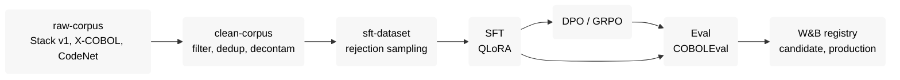

# On-Prem CodeGen

Domain-adapts an open code model to COBOL and serves it on our own hardware, with no external model APIs.
Every dataset, run, sweep and eval is tracked in Weights & Biases. Project brief: [docs/one-pager.pdf](docs/one-pager.pdf).

> **Status:** in progress. Data (collect, clean, CodeNet task pool, rejection sampling), SFT and the baseline eval exist.
> Preference tuning, serving and the model registry are not written yet.

## Pipeline



Each stage reads its inputs from W&B artifacts and logs new versions, so lineage from raw corpus to deployed model is automatic.

## Key decisions

| Area | Decision |
|---|---|
| Language, benchmark | **COBOL**; COBOLEval executed with GnuCOBOL. pass@1/pass@10, compile rate, HumanEval-Python for forgetting. |
| Base model | **`Qwen/Qwen3.8-27B`** (dense, Apache 2.0). Text part only; vision encoder frozen. |
| Fine-tuning | QLoRA (4-bit) on 1× 80 GB. SFT in non-thinking mode; eval in both modes. |
| Preference tuning | DPO on offline pass/fail pairs. GRPO (compile + test reward) is a stretch goal on 2× 80 GB. |
| Data | Stack v1 (full, we dedup), X-COBOL, CodeNet. Files are flagged (`kept`, `filter_reason`), never deleted. `.cpy` copybooks are excluded from SFT. |
| Instruction data | Rejection sampling: keep only generations that compile and pass the tests. |
| Reference | [COBOL-Coder](https://arxiv.org/html/2604.03986v1) (Dau et al.): compiler-guided validation and similarity filtering. |
| Tracking | Hosted W&B (run metadata leaves premises; data is public). |
| Compute | Vast.ai, 1× 80 GB by default, 2× 80 GB for GRPO and final runs. Ephemeral instances. |
| Serving | vLLM, OpenAI-compatible, over an SSH tunnel. OpenCode is the demo client. |
| Stack | TRL + PEFT, Hydra configs per stage, pinned `requirements.txt`. |

## Project structure

Keep this section up to date whenever you add, move or remove a top-level directory or module.

```
.
├── benchmarks/              # eval benchmarks, downloaded at pinned commits (gitignored, never trained on)
├── configs/                 # per stage: data/ and eval/ (yaml), train/ (Hydra)
├── data/                    # local scratch, gitignored except manifests/ (one YAML per source)
├── docker/                  # train, serve, eval-sandbox images
├── docs/                    # project brief, dataset plan, contracts, project-log.md, evaluation reports
├── scripts/                 # vast_onstart.sh: bootstrap a Vast.ai instance
├── src/onprem_codegen/
│   ├── prompt.py            # build_prompt, shared by SFT data and eval
│   ├── utils.py
│   ├── data/                # collect, filters, dedup, decontaminate, clean, CodeNet, rejection sampling
│   ├── train/               # SFT (DPO, GRPO planned)
│   ├── eval/                # sandboxed execute(), benchmark loader, generate -> execute -> metrics -> W&B
│   └── serve/               # adapter export, demo client helpers (planned)
├── tests/
├── tasks/                   # plan and todo
├── docker-compose.yml       # local GPU box only
├── Makefile                 # entry points
└── .env.example
```

## Setup

```bash
git clone <repo-url> && cd on-prem-code-generation
pip install -r requirements.txt
cp .env.example .env        # WANDB_*, HF_TOKEN, VLLM_VERSION
make test
```

| Command | What it does |
|---|---|
| `make codenet` | CodeNet COBOL parts and `task-pool` artifact |
| `make data` | `raw-corpus` then `clean-corpus` |
| `make sft-data` | rejection sampling against the vLLM server, then `sft-dataset` |
| `make train` | SFT (`make train-smoke` for a smoke run, `make train-dryrun` for the 27B kill-and-resume check) |
| `make benchmarks` | fetch pinned benchmarks, log `benchmark-*` artifacts |
| `make eval` | generate, execute, metrics (also `eval-generate`, `eval-execute`) |

## Running on Vast.ai

Instances are containers, so there is no `docker compose`. Rules: ≥ 200 GB disk, datacenter hosts, secrets
(`WANDB_API_KEY`, `WANDB_ENTITY`, `WANDB_PROJECT`, `HF_TOKEN`, `GITHUB_TOKEN`) set once under
**Account → Environment Variables**, never baked into images. Every stage must restart on a fresh instance
(inputs and outputs in W&B, checkpoints with resume). Destroy the instance when done.

```bash
# build and push images (Linux x86 recommended)
docker buildx build --platform linux/amd64 -f docker/train.Dockerfile -t $REG/onprem-codegen-train:$TAG --push .

# rent, connect, run
vastai search offers 'num_gpus=1 gpu_ram>=80 disk_space>=200 datacenter=true reliability>0.98' -o 'dph'
vastai create instance <OFFER_ID> --image $REG/onprem-codegen-train:$TAG --disk 200 --ssh --direct
ssh -p <PORT> root@<HOST>
cd /workspace && git clone <repo-url> && cd on-prem-code-generation
tmux new -s run
python -m onprem_codegen.train.sft ...

vastai destroy instance <INSTANCE_ID>
```

Smoke test without a custom image: start from `pytorch/pytorch:2.11.0-cuda12.8-cudnn9-devel` with
`--onstart scripts/vast_onstart.sh`.

**Serving:** start from the `onprem-codegen-serve` image, fetch the adapter
(`wandb artifact get <entity>/<project>/adapter:production --root /adapters/cobol`), run `serve-entrypoint.sh`,
then tunnel with `ssh -p <PORT> root@<HOST> -N -L 8000:localhost:8000`. `localhost:8000/v1/models` lists `base` and `cobol`.

## Eval

Generation needs only the vLLM server (over the tunnel); execution needs the `eval-sandbox` image
(no network, read-only, resource-capped). Vast has no Docker, so execution runs locally.
Settings: `configs/eval/baseline.yaml` (`smoke.yaml`: fewer thinking samples, for a quick check with `--limit`),
sampling per mode in `data/manifests/benchmarks.yaml`.

```bash
docker build -f docker/eval-sandbox.Dockerfile -t onprem-codegen/eval-sandbox .   # once
make benchmarks
make eval-generate                                                  # on the Vast instance
make eval-execute ARGS="--generations eval-generations:baseline"    # locally, in the sandbox
```

## Local GPU box

```bash
docker compose build
docker compose run --rm train python -m onprem_codegen.train.sft ...
docker compose up serve                                  # 127.0.0.1:8000
docker compose run --rm eval-sandbox cobc -x prog.cbl
```
