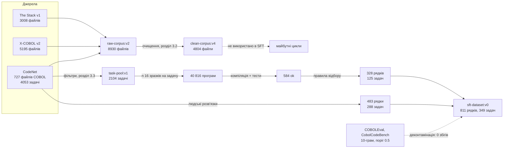
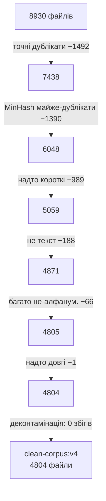
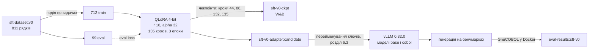

# Проміжний звіт: адаптація Qwen3.8-27B до COBOL (дані, baseline, LoRA, результати)

Стан на 7 листопада 2026. Усі числа взяті з `docs/project-log.md`, `docs/baseline.md`, `docs/sft-v0.md` і W&B-проєкту `mllab-team/onprem-codegen`; кожен запуск має коміт і посилання (розділ 11).

## 1. Підсумок

**Мета.** Адаптувати відкриту кодову модель до COBOL (мова з малою кількістю даних) повністю на власній інфраструктурі, без зовнішніх API, з відстеженням кожного датасету, запуску й оцінки у Weights & Biases.

| Етап | Результат | Розділ |
|---|---|---|
| Дані | 8930 COBOL-файлів → 4804 після очищення; 2104 задачі CodeNet з тестами; **811 навчальних прикладів на 349 задачах**, 0 збігів з бенчмарками | 3 |
| Baseline | COBOLEval: pass@1 greedy 4.3%, compile 11.4%; HumanEval-Python 97.2%. Запас для покращення підтверджено | 5 |
| LoRA | QLoRA r 16 на 712 прикладах, 135 кроків, ~35 хв на одному GPU; eval loss 0.217 (після 1-ї епохи) → 0.175, перенавчання немає | 6 |
| Заморожений протокол | **Покращення немає:** COBOLEval pass@1 greedy 0.043 → 0.000, HumanEval-Python sampled −3.4 пункти, CobolCodeBench completion sampled 0.008 → 0.020 (інтервал торкається 0) | 7.1 |
| Post hoc | **Основний результат:** після усунення двох артефактів формату `sft-v0` кращий за baseline на COBOLEval | 7.3 |
| Дефекти | Шість дефектів, які без перевірки дали б хибні висновки; чотири усунуто, два враховано в sft-v1 | 8 |
| Далі | `sft-v1` з виправленим промптом і даними, критерії успіху фіксуються до навчання | 10 |

**Основний результат.** `sft-v0` кращий за baseline на COBOLEval, коли усунуто відступ першого рядка в промпті і `STOP RUN` у навчальних даних:

| Метрика | baseline | sft-v0 |
|---|---|---|
| pass@1 greedy | 0.062 | **0.322** |
| pass@10 sampled | 0.300 | **0.608** |
| compile rate (greedy) | 0.12 | **0.65** |

Числа отримано post hoc на збережених відповідях. Правки обрано після побачених невдач, тож це пояснення заморожених результатів, а не їхня заміна (розділ 7.3).

## 2. Постановка і підхід

| Параметр | Значення |
|---|---|
| Мова і бенчмарк | COBOL, виконання в GnuCOBOL 3.2.0 |
| Модель | `Qwen/Qwen3.8-27B`: dense, гібрид Gated DeltaNet і Gated Attention, thinking за замовчуванням, Apache 2.0. Тренується лише текстова частина |
| Метод | QLoRA 4-bit, LoRA r 16, alpha 32, dropout 0.05, модулі уваги, Gated DeltaNet і MLP: 116 727 808 тренованих параметрів |
| Стек | TRL + PEFT, конфіги Hydra |
| Інфраструктура | Vast.ai (інстанси ефемерні, усе відновлюється з W&B), vLLM 0.32.0, Docker-пісочниця без мережі й лише для читання |
| Конвеєр | збір → очищення → інструкційні дані (rejection sampling) → SFT → оцінка → (далі) реєстрація моделі |
| Опорна стаття | COBOL-Coder (Dau et al., arXiv:2604.03986): фільтрація даних за компілятором |

Стаття використовує GPT-4o, зокрема щоб виправляти файли, які не компілюються. Ми зовнішніх API не викликаємо: генерує сама Qwen, а справжній код не виправляємо, лише позначаємо.

## 3. Дані

### 3.1 Джерела

| Джерело | Що це | Файлів / одиниць | Роль |
|---|---|---|---|
| The Stack v1 (повний, не `-dedup`), підмножина COBOL | код з GitHub, ревізія `153f6301…` | 3008 | навчання (сировина) |
| X-COBOL v2 | COBOL-файли з 168 GitHub-репозиторіїв | 5195 | навчання (сировина) |
| IBM Project CodeNet | олімпіадні задачі, умови, тести, розв'язки | 727 COBOL-файлів; 4053 задачі | задачі й розв'язки |
| COBOLEval | HumanEval, перекладений на COBOL | 146 задач | лише оцінка |
| CobolCodeBench | складніші задачі (корпоративний стиль) | 46 задач × 2 режими | лише оцінка |
| HumanEval-Python | перевірка забування Python | 164 задачі | лише оцінка |
| MainframeBench | питання про мейнфрейм | в маніфесті, не використовувався | зарезервовано для оцінки |

Джерела з роллю `eval_only` ніколи не потрапляють у навчання, це перевіряє скрипт деконтамінації. Ліцензії тільки позначаємо (`license_ok`), як фільтр не використовуємо; ліцензію CodeNet ще треба підтвердити.

### 3.2 Очищення: `raw-corpus:v2` → `clean-corpus:v4`

Фільтри застосовуються по черзі. Вхід: 8930 файлів, 511.7 МБ; вихід: 4804 файли, 66.0 МБ.

| Джерело | Було | Точні дублікати | Майже-дублікати | Надто короткі | Не текст | Багато не-алфанум. | Надто довгі | Залишилось |
|---|---|---|---|---|---|---|---|---|
| The Stack | 3008 | 0 | 396 | 540 | 14 | 50 | 0 | 2008 |
| X-COBOL | 5195 | 1452 | 951 | 346 | 174 | 16 | 1 | 2255 |
| CodeNet | 727 | 40 | 43 | 103 | 0 | 0 | 0 | 541 |
| **Разом** | **8930** | 1492 | 1390 | 989 | 188 | 66 | 1 | **4804** |

| Перевірка | Результат |
|---|---|
| Синтаксис компілятором (лише позначка, файли не виправляємо) | ok 2446, compile_error 2140, пропущено `.cpy` 218 |
| Прапори компілятора (50 випадкових файлів) | «чистий» запуск 18/50, `-std=ibm` 17/50, `-std=ibm -free` 8/50; прапори не потрібні |
| Копібуки (`.cpy`) | лишаються в корпусі як залежності, у SFT не потрапляють |
| Походження | `clean-corpus:v3` мав хибне походження (`raw-corpus:v0`), замінений на v4 |

### 3.3 Набір задач: `task-pool:v1`

З CodeNet: 4053 задачі, 3867 з тестами, **2104 лишилось**. Кожна задача має один тест (перший приклад з умови).

| Відкинуто | Задач |
|---|---|
| з зображеннями | 893 |
| не-ASCII | 862 |
| без тестів | 186 |
| надто довгі | 8 |

### 3.4 Rejection sampling: як отримано інструкційні дані

Модель генерує розв'язки для кожної задачі, лишаємо тільки ті, що компілюються в GnuCOBOL і проходять тести.

| Параметр | Значення |
|---|---|
| Генерація | n 16, temperature 0.7, top_p 0.8, max_tokens 2048, non-thinking (як і навчання) |
| Підказки | правила в запиті (`generation_hints`); у навчальний промпт не потрапляють |

**Підбір підказок на 20 задачах** (320 зразків на конфіг):

| Конфіг | Розв'язано задач з 20 | Помилок компіляції з 320 |
|---|---|---|
| без підказок | 1 (242 з 305 програм читали stdin як файл, `ASSIGN TO STDIN`) | 263 |
| промпт `ACCEPT`/`DISPLAY` + 4 кумулятивні підказки* | 5 | 226 |

\* правопис `WORKING-STORAGE`, імена з `WS-`, колонки 8–72; заборона файлів; числа без провідних нулів.

**Складність різна.** Перші 500 задач за порядком ідентифікаторів (AOJ та ранні AtCoder, легші) дали 17 розв'язаних, випадкові 40 з решти дали 5.

| Бал AtCoder | ≤ 300 | 400–500 | ≥ 600 |
|---|---|---|---|
| Розв'язано | 4 з 18 | 1 з 9 | 0 з 8 |

**Повний прогін:** 2104 задачі, 40 816 зразків.

| Статус | Зразків | Частка |
|---|---|---|
| compile_error | 24 027 | 58.9% |
| no_program (11 471 з 11 476 обрізані) | 11 476 | 28.1% |
| wrong_output | 4167 | 10.2% |
| timeout | 244 | 0.6% |
| runtime_error | 35 | 0.1% |
| **ok** | **867** | **2.1%** |

**Одного тесту замало.** Усі 867 `ok` перевірено повторно на інших прикладах з умови.

| Перевірка | Результат |
|---|---|
| Програм з додатковим тестом | 814 з 867 |
| Пройшли єдиний тест випадково | 283 з 814 (34.8%); приклад: задача на 2400 балів «розв'язана» через `IF N > 100` |
| Проходять усі приклади | 531 з 814 |
| Задач залишилось розв'язаними | 128 зі 233 |
| Контроль: людські розв'язки CodeNet у тій самій пісочниці (ігноруючи пробіли) | 497 з 520 |

**Правила відбору:**

| Тип рядка | Умова |
|---|---|
| згенерований | ≥ 2 пройдених тести (відкидає 53 програми на 17 задачах), ≤ 500 балів (6 рядків на 3 задачах), без «захардкодженого» виводу |
| людський | працює на тесті задачі |

Після повторної перевірки `ok`: 867 → 584.

### 3.5 Навчальний набір `sft-dataset:v0`

| Джерело | Рядків | Задач | Токенів (медіана / p90 / макс) |
|---|---|---|---|
| rejection_sampling (згенеровані, перевірені) | 328 | 125 | 566 / 881 / 1784 |
| codenet_cobol (людські розв'язки) | 483 | 288 | 614 / 1109 / 3620 |
| **Разом** | **811** | **349** | 599 / 1014 / 3620 |

| Показник | Значення |
|---|---|
| Відкинуто при формуванні | `over_cap` 222, `few_tests` 53, `too_hard` 6 |
| Задач розв'язано моделлю | 145 (6.9% пулу) |
| Деконтамінація | 10-грам шингли, поріг 0.5, проти 146 + 92 задач бенчмарків: 0 збігів |
| Якість | жодна відповідь не обрізана, дублікатів немає, 155 задач мають по одному рядку, максимум 8 рядків на задачу; ручний перегляд 20 випадкових рядків: придатні |
| Формат | усі 811 промптів у стилі «stdin → stdout»; 0 з 811 мають `LINKAGE SECTION`; 51 працюють з файлами; 99% читають `ACCEPT`; 799 містять `STOP RUN` |

Бенчмарки мають інший формат (розділ 7.3).

### 3.6 Що зібрано, але не використано

`clean-corpus:v4` (4804 файли реального COBOL, у тому числі стилю мейнфрейму) у SFT не пішов: для SFT потрібні пари «умова → перевірена програма», а у корпусі є лише код без умов і тестів. У наступних циклах це джерело даних у форматах бенчмарків.

## 4. Протокол оцінки

| Параметр | Значення |
|---|---|
| Бенчмарки | COBOLEval (146 задач, функції з `LINKAGE`, результат у `RESULT`); CobolCodeBench (46 задач, режими completion та instruct, файловий I/O); HumanEval-Python (164 задачі, регресія) |
| Виконання | GnuCOBOL 3.2.0 у Docker (з вихідних кодів, sha256-прив'язаний), без мережі, лише читання, з обмеженнями ресурсів |
| Стеля CobolCodeBench | еталонні розв'язки проходять 29/46 на 3.1.2 і 38/46 на 3.2.0, тож стеля 38/46 |
| Non-thinking | greedy (temperature 0, 3 запуски); sampled (temperature 0.7, top_p 0.8, n 20, до 4096 нових токенів) |
| Thinking | temperature 0.6, top_p 0.95, до 28 000 токенів |
| Метрики | compile rate, pass@1 і pass@10 (незміщена оцінка Chen et al.), частка обрізаних відповідей |
| Різниця між моделями | парний bootstrap по задачах (2000 перевибірок, 95% інтервал) |
| Заморожування | конфіги й протокол baseline не змінюються без нового baseline; артефакти закріплено aliases `baseline-final-*`; тест гарантує, що конфіг адаптера відрізняється від baseline лише адаптером, іменем запуску, served-моделлю і режимом |

## 5. Baseline (сира модель)

| Параметр | Значення |
|---|---|
| Інфраструктура | vLLM на 1× A100 80 GB; генерація на інстансі в tmux, виконання локально в Docker (на Vast Docker немає) |
| Non-thinking, повний протокол | 2 год 41 хв |
| Thinking, скорочено | лише COBOLEval і HumanEval-Python, sampled n 10: COBOLEval 12 год 55 хв, HumanEval-Python 88 хв. Повний thinking n 20 на всіх бенчмарках зайняв би ~4.5 доби (відповіді ~21 тис. токенів) |

| Бенчмарк | Режим | Декодування | pass@1 [95% CI] | pass@10 [95% CI] | compile | обрізано |
|---|---|---|---|---|---|---|
| COBOLEval (146) | non-thinking | greedy | 0.043 [0.018, 0.078] | | 0.114 | 0.016 |
| COBOLEval | non-thinking | sampled | 0.019 [0.013, 0.026] | 0.150 [0.105, 0.195] | 0.097 | 0.006 |
| COBOLEval | thinking | sampled n 10 | 0.051 [0.036, 0.070] | 0.281 [0.212, 0.356] | 0.064 | 0.375 |
| CobolCodeBench completion (46) | non-thinking | greedy | 0.007 [0.000, 0.022] | | 0.116 | 0.304 |
| CobolCodeBench completion | non-thinking | sampled | 0.008 [0.000, 0.018] | 0.048 [0.000, 0.109] | 0.111 | 0.102 |
| CobolCodeBench instruct (46) | non-thinking | greedy | 0.000 | | 0.145 | 0.116 |
| CobolCodeBench instruct | non-thinking | sampled | 0.001 [0.000, 0.003] | 0.011 [0.000, 0.033] | 0.109 | 0.045 |
| HumanEval-Python (164) | non-thinking | greedy | 0.972 [0.949, 0.992] | | 0.998 | 0.002 |
| HumanEval-Python | non-thinking | sampled | 0.969 [0.947, 0.985] | 0.994 [0.982, 1.000] | 0.999 | 0.001 |
| HumanEval-Python | thinking | sampled n 10 | 0.962 [0.933, 0.985] | 0.976 [0.951, 0.994] | 0.982 | 0.017 |

| Висновок | Підстава |
|---|---|
| Запас для покращення підтверджено | на COBOL модель компілює ~10% програм і розв'язує < 5% задач, на Python 97% |
| Thinking краще на COBOLEval | pass@10 0.281 проти 0.150; 37.5% відповідей обрізані на 28 000 токенів, тож це нижня оцінка |
| Обрізання на CobolCodeBench completion | greedy 30.4% (42 з 138; 29 з 46 задач): модель вироджується в нескінченні нумеровані оголошення (`WS-TEMP-COUNTER-52`, `-53`…). Це провал моделі, а не протоколу, тому ліміт токенів не змінювали |
| Шум на CobolCodeBench | 46 задач, інтервали широкі (нижня межа 0), baseline практично нульовий |

## 6. LoRA: як отримано й що вийшло

### 6.1 Підготовка

| Запуск | Що зробили | Результат |
|---|---|---|
| Smoke і dry run | 20 кроків на 100 коротких smoke-рядках | loss 0.077, 19.6 GB; 27B QLoRA влазить, split, eval loss і збереження працюють |
| B1 (репетиція на реальних даних) | 20 + 5 кроків на `sft-dataset:v0`, 712 train / 99 eval | пік пам'яті 23.9 GB, ~15.3 с/крок; відновлення з чекпоінта W&B після видалення локальних файлів: той самий запуск продовжив з кроку 20 |

З B1 порахували бюджет: ~45 кроків на епоху, 3 епохи ≈ 35 хв.

### 6.2 Навчання `sft-v0`

| Параметр | Значення |
|---|---|
| Дані | `sft-dataset:v0` (alias `decontaminated`), 712 train / 99 eval (поділ по задачах) |
| Метод | QLoRA 4-bit, r 16, alpha 32, dropout 0.05, 12 типів модулів |
| Оптимізація | lr 2e-4 (cosine), батч 1 × накопичення 16, `max_length` 4096 (нічого не відкинуто), 3 епохи |
| Результат | 135 кроків, 26.2 GB пік, 15.2 с/крок, 1× RTX PRO 6000 Blackwell (98 GB), коміт `9c4da41` |

| Крок | 44 (епоха 1) | 88 (епоха 2) | 132 (епоха 3) | 135 (кінець) |
|---|---|---|---|---|
| Eval loss | 0.2170 | 0.1793 | 0.1752 | 0.1752 |
| Eval token accuracy | 0.9339 | 0.9438 | 0.9453 | 0.9457 |

Train loss 0.55 → 0.137. Eval loss виходить на плато між 2-ю і 3-ю епохою й не зростає, тож перенавчання немає. Eval-рядки це задачі, яких модель не бачила під час навчання. Eval loss до навчання не міряли.

### 6.3 Підключення адаптера до vLLM і прихований збій

vLLM віддає `base` і `cobol` (база + адаптер) одночасно. Перший запуск виглядав успішним, але адаптер не застосовувався.

| | |
|---|---|
| Симптом | на фіксованому тексті COBOL сума логарифмів ймовірностей однакова до 6 знаків (−66.002127) в обох моделей |
| Причина | тренування на текстовому класі зберігає ключі `model.layers.N…`, а vLLM шукає `model.language_model.layers.N…`; жоден з 496 модулів не збігся, і vLLM не повідомив про помилку |
| Виправлення | `serve/adapter_keys.py`: збігаються 496 з 496 модулів; логіти відрізняються (−66.0021 проти −62.9725) |
| Захист | `serve.check` падає, якщо адаптер не змінює логіти |

## 7. Результати sft-v0 та аналіз

### 7.1 Основна таблиця (заморожений протокол, non-thinking)

| Група | pass@1 base → sft-v0 | Δ pass@1 [95% CI] | pass@10 base → sft-v0 | compile base → sft-v0 | обрізано base → sft-v0 |
|---|---|---|---|---|---|
| COBOLEval greedy | 0.043 → 0.000 | −0.043 [−0.075, −0.016] | | 0.114 → 0.000 | 0.016 → 0.034 |
| COBOLEval sampled | 0.019 → 0.003 | −0.015 [−0.023, −0.009] | 0.150 → 0.028 | 0.097 → 0.141 | 0.006 → 0.021 |
| CobolCodeBench completion greedy | 0.007 → 0.000 | −0.007 [−0.022, +0.000] | | 0.116 → 0.094 | 0.304 → 0.565 |
| CobolCodeBench completion sampled | 0.008 → 0.020 | +0.012 [+0.000, +0.027] | 0.048 → 0.083 | 0.111 → 0.134 | 0.102 → 0.325 |
| CobolCodeBench instruct greedy | 0.000 → 0.000 | 0.000 | | 0.145 → 0.130 | 0.116 → 0.101 |
| CobolCodeBench instruct sampled | 0.001 → 0.000 | −0.001 [−0.003, +0.000] | 0.011 → 0.000 | 0.109 → 0.155 | 0.045 → 0.067 |
| HumanEval-Python greedy | 0.972 → 0.959 | −0.012 [−0.043, +0.018] | | 0.998 → 1.000 | 0.002 → 0.000 |
| HumanEval-Python sampled | 0.969 → 0.934 | −0.034 [−0.057, −0.014] | 0.994 → 0.986 | 0.999 → 0.999 | 0.001 → 0.001 |

Критерій успіху з плану: COBOLEval pass@1 вищий за baseline поза інтервалом, compile rate вищий, HumanEval-Python падає не більше ніж на 2 пункти. **Не виконано.**

### 7.2 Аналіз по бенчмарках

| Бенчмарк | Висновок |
|---|---|
| COBOLEval | Гірше: pass@1 і pass@10 впали, інтервали різниці не включають 0. Compile rate у greedy 0 (причини в 7.3), у sampled трохи вищий (0.097 → 0.141) |
| CobolCodeBench completion | Невеликий приріст у sampled (pass@1 +0.012, pass@10 +0.035), але інтервал торкається 0 і задач лише 46, тож це не доведено. Окрема регресія: обрізання сильно зросло (greedy 0.304 → 0.565, sampled 0.102 → 0.325), модель частіше потрапляє у цикл повторюваних оголошень |
| CobolCodeBench instruct | Обидві моделі практично нульові, змін немає |
| HumanEval-Python | Помірне забування: greedy −1.2 пункти (інтервал включає 0), sampled −3.4 пункти (інтервал [−0.057, −0.014]); критерій допускав 2 |

SFT на 712 stdin-програмах не покращив жоден бенчмарк за замороженим протоколом і дещо погіршив Python.

### 7.3 Чому COBOLEval впав: два артефакти формату (post hoc, локально)

Усі числа цього підрозділу отримано повторним виконанням уже збережених відповідей, без W&B і без нових генерацій. Вони пояснюють заморожений результат і не замінюють його.

| Артефакт | Механізм | Масштаб |
|---|---|---|
| Відступ першого рядка | Промпт COBOLEval починається з 7 пробілів, але `build_prompt` викликає `.strip()`, і модель бачить `IDENTIFICATION DIVISION.` у колонці 1. Для фіксованого формату COBOL це помилка `invalid indicator 'F' at column 7`. Baseline сам виправляє відступ (402 з 438 greedy-відповідей), `sft-v0` копіює промпт дослівно (0 з 438) | 417 з 423 помилок компіляції у greedy; зачіпає всі 146 промптів COBOLEval і всі 46 CobolCodeBench completion |
| `STOP RUN` з навчальних даних | 799 з 811 навчальних програм його містять. `sft-v0` пише його у 84% програм і жодного разу `GOBACK` (baseline: 33% і 37 програм). У COBOLEval програма викликається як підпрограма, де `STOP RUN` завершує процес до повернення результату | 264 з 271 неправильних виходів містять `STOP RUN` |

| Варіант | Метрика | base | sft-v0 | Δ [95% CI] |
|---|---|---|---|---|
| заморожений протокол | pass@1 greedy | 0.043 | 0.000 | −0.043 [−0.075, −0.016] |
| відступ відновлено | compile greedy / sampled | 0.121 / 0.132 | **0.646 / 0.589** | |
| відступ відновлено | pass@1 greedy | 0.043 | 0.007 | −0.037 [−0.071, −0.005] |
| відступ відновлено | pass@10 sampled | 0.196 | 0.088 | −0.108 [−0.168, −0.050] |
| відступ + `STOP RUN`→`GOBACK` | pass@1 greedy | 0.062 | **0.322** | +0.260 [+0.192, +0.326] |
| відступ + `STOP RUN`→`GOBACK` | pass@1 sampled | 0.058 | **0.264** | +0.207 [+0.168, +0.249] |
| відступ + `STOP RUN`→`GOBACK` | pass@10 sampled | 0.300 | **0.608** | +0.308 [+0.240, +0.373] |

Після усунення обох артефактів знак результату змінюється: правильних greedy-програм 27 у baseline проти 141 у `sft-v0`. Модель навчилась писати компільований COBOL (compile rate 0.12 → 0.65) і, коли формат не заважає, краща за baseline на COBOLEval. Baseline теж виграє від виправлення (sampled pass@1 0.019 → 0.030 лише від відступу), тож заморожений baseline на COBOLEval занижений.

Це свідчення, що обмежує формат, і підстава для наступного циклу, але не результат `sft-v0`: правки обрано після побачених невдач, а друга переписує відповідь моделі, чого в реальному використанні ніхто не зробить.

## 8. Знайдені проблеми і рішення

| Проблема | Як виявили | Рішення | Статус |
|---|---|---|---|
| Парсер thinking брав перший блок коду з міркувань (шаблон Qwen кладе `<think>` у промпт, у відповіді лише `</think>`) | HumanEval thinking pass@1 0.271, нереалістично нижче non-thinking | розбивати по останньому `</think>`; старі генерації перероблено без повторної генерації; 0.271 → 0.962 | усунуто |
| Один тест на задачу пропускав хибні програми | задача на 2400 балів «розв'язана» тривіальним `IF` | усі `ok` повторно перевірені на всіх прикладах умови; мінімум 2 тести (розділ 3.4) | усунуто |
| Адаптер у vLLM завантажено, але не застосовано | логіти `cobol` ≡ `base` до 6 знаків | перейменування ключів, перевірка в `serve.check` (розділ 6.3) | усунуто |
| Run-и записані на акаунт іншої людини | W&B показав чужого автора | ключ береться зі змінних акаунта Vast; наступні інстанси зі своїм ключем | усунуто |
| `build_prompt` зрізає відступ першого рядка | 417 помилок `invalid indicator 'F'` у COBOLEval (розділ 7.3) | виправлення до заморожування baseline v2 | план sft-v1 |
| `STOP RUN` у 99% навчальних програм | аналіз неправильних виходів (розділ 7.3) | дані з `GOBACK` | план sft-v1 |

## 9. Обмеження

| Обмеження | Наслідок |
|---|---|
| Один запуск, один seed, одна конфігурація | шум самого навчання невідомий, інтервали враховують лише вибірку задач; sweep (lr, r) не робили |
| Малий навчальний набір (712 рядків), лише stdin-програми CodeNet | формати бенчмарків (`LINKAGE`, файли) відсутні; це було відомо до навчання (v0 тренували як є, щоб виміряти перенос) |
| Немає незміщеного тесту на розподілі навчання | `task-pool` відфільтровано через baseline: з 1755 задач поза навчанням лише 19 мали хоч один прохідний зразок baseline, тож порівняння на них було б зміщене проти baseline |
| Thinking-режим для адаптера не міряли (~15 год GPU) | немає порівняння thinking base → sft-v0; CobolCodeBench у thinking не міряли й для baseline |
| CobolCodeBench: 46 задач | широкі інтервали; 8 із 46 завдань з недетермінованим виводом мають відомі збої еталону, стеля 38/46 |
| Діагностика post hoc | пояснює, але не доводить; до заморожування baseline v2 її слід перевірити чистим циклом |

## 10. Наступний крок: sft-v1

Детальний план у `tasks/plan-full-run.md`.

| # | Крок |
|---|---|
| 1 | Виправити `build_prompt` (зберігати відступ) і перемірити baseline v2 на зачеплених групах |
| 2 | Дані `v1-lite`: ті самі перевірені програми, але з `GOBACK` (повторно перевірені тестами), без утримуваних 20% задач |
| 3 | Утримати 20% задач CodeNet (випадковий вибір до будь-яких результатів) для незміщеного тесту «навчання працює» |
| 4 | Зафіксувати й закомітити критерії успіху до навчання; подати результат за ними без правок відповідей |
| 5 | Якщо COBOLEval не покращиться, а утримані задачі покажуть приріст: дані у форматі COBOLEval (`LINKAGE`, `RESULT`) з `clean-corpus`. Якщо Python просяде: Python-міксин |

## 11. Відтворюваність: артефакти й запуски

| Що | Де |
|---|---|
| Сирі й очищені дані | W&B: `raw-corpus:v2` (коміт `ddec071`), `clean-corpus:v4` (коміт `0ff425b`) |
| Задачі | `task-pool:v1` (коміт `e3c6c9a`) |
| Навчальний набір | `sft-dataset:v0`, alias `decontaminated` (запуск `7b6m2nvv`, коміт `6388dd6`; деконтамінація `jh9xasa1`) |
| Baseline (non-thinking) | генерація `4q4hi07a`, метрики `al1olufk`; aliases `baseline-final-non-thinking` |
| Baseline (thinking) | `ada15z6w` (COBOLEval), `6epckk6y` (HumanEval-Python); aliases `baseline-final-thinking-*` |
| Репетиція навчання | `sft-b1` (коміт `8e531fa`) |
| Навчання | `sft-v0` (коміт `9c4da41`), адаптер `sft-v0-adapter:candidate`, чекпоінти `sft-v0-ckpt` |
| Генерація і виконання sft-v0 | `o47hz4el`, `ke91f26o`; `eval-generations:sft-v0`, `eval-results:sft-v0` |
| Код пайплайну | `src/onprem_codegen/{data,train,eval,serve}`, `scripts/vast_serve.sh`, конфіги в `configs/` |
| Документи | `docs/project-log.md` (усі числа), `docs/baseline.md`, `docs/sft-v0.md` |
| GPU | A100 80 GB (baseline), H100/H200 NVL (rejection sampling), RTX PRO 6000 Blackwell 98 GB (навчання й генерація sft-v0) |
| Тести | 145 passed, 4 skipped |
